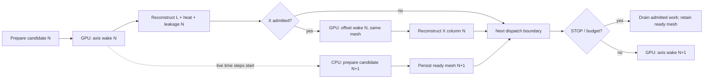

# WF7 — local Wakis HOM search

Canonical branch: `workflow/7-wakis-hom`. This package is workflow-specific;
the shared CST wrappers remain in `src/cst_optimization`.

Each complete candidate uses one axis wake and one +2 mm X-drive wake on
the same candidate-specific FIT mesh. Axis data also supplies the two solid1
surface heating estimates and port2/3 working-mode leakage. PW witness
derivatives stay on axis; source differencing produces only the X column
`[Zxx, Zyx]`. Y is unmeasured, never zero-filled.

## Search contract

Fifteen independent parameters in the 2026-10-15 geometry revision: fix
`UpperHeight1=UpperHeight2=170` and `DownHeight2=-30`; search `DownHeight`
over 50–180 mm. `coaxr2` maps to the template's actual `coax_r2` parameter.
All lengths are mm; angles are degrees. `PortR2 = PortR1 + 2`;
`5.43 < coaxr2 < 22` and `coaxr2 >= PortR2`. The derived constraint also
requires `PortR1 < 20`. Samples are drawn inside the feasible domain,
without clipping invalid values onto boundaries.

Longitudinal reconstructed HOM peak <=1800 ohm; X transverse column norm
<=150000 ohm/m; each port2/3 leakage strictly <75 W. Minimize the larger
solid1 heat load and retain both component values. There is no 150 W stop.
Longitudinal excess has first priority. A finite longitudinal sensitivity
upper envelope <=3000 ohm admits X; about 20% of measured active time is
reserved for cross-gate exploration. Independent partial-observation GPs
use reconstructed estimates and heteroscedastic uncertainty, never direct
FT proxies. Earlier geometries are reference-only, not native training data.

GPs quarantine contradictory evidence and unbounded peaks whose lower
envelope does not establish their scale: lower <=0/missing, center/lower >4,
or relative uncertainty >3. The original observations and failure reasons
remain unchanged. Supported unbounded estimates may guide trends with a
log-space noise floor ln(3); bounded unqualified estimates use ln(1.5).
All metrics also carry a 5%-of-threshold absolute noise floor (150 W is the
heat reference), preventing tiny unresolved leakage values from dominating.
These are engineering regularization assumptions, not calibrated probabilities.
At least six independent accepted points are needed per GP. A smooth
confidence-bound utility uses upper predictive values for L/leak constraints
and lower values for X/heat exploration (beta=0.75); it never certifies a limit.

Axis-only candidates can now seed local search. Half the proposal pool is
local and half global. A local proposal captures the center's bounded L,
heat and available leakage envelopes at selection time; unknown X is omitted
equally from both sides of this radius comparison. Two disjoint improvements
expand radius by 1.5; three disjoint worsenings shrink it by 0.7, bounded to
0.05–0.5 in normalized coordinates. Overlap, unbounded evidence, contradictory
fits, global proposals and solver failures do not change these counters.
Each axis result updates once; radius-generation changes invalidate already
prefetched proposals for further counter updates. GP fitting still uses their
accepted observations. Proposal/result journals retain the comparison details.

Sigma=70 mm; wake length=35 m; HOM band=550–1462.7348957 MHz. Working-mode
power uses 500 kV peak transit-time voltage, CW, beta=1 and copper
conductivity 5.8e7 S/m. Only `component5:solid1` and `component6:solid1`
count toward heating. Net physical Poynting flux at three coax planes is
reported as leakage, not as Qe from unmeasured stored energy. Power carries
at least 20% heuristic sensitivity; poor fit/window/plane consistency is
unresolved and cannot certify feasibility. No full transverse or out-of-band
suppression claim is made.

## Run and recovery

Use an explicit untracked `config.local.json`. The GPU environment must have
CuPy, Wakis dependencies, h5py, psutil, scipy and scikit-learn. Pin the Wakis
checkout to `e0d8f2f1e0e2b58e0f675ded71b32917a18dadfe`; tracked upstream
modifications are refused. Use the repository `.venv` for no-CST tests;
process ownership tests additionally require psutil (validated with 7.2.2).

```powershell
python -m workflows.rfgun_wakis.campaign init --config config.local.json --baseline baseline.json
python -m workflows.rfgun_wakis.campaign run --config config.local.json
python -m workflows.rfgun_wakis.campaign status --config config.local.json
```

An optional `import-baseline --import-spec native.json` registers the current
template's already completed axis/X preflight. It verifies geometry, expanded
parameters, current solver identity and all numeric manifests before doing so.
This path is idempotent and only available before dispatch. Its field and
analysis costs remain explicit in `native_baseline_import.json`, separate from
the subsequent round; the same native baseline is never solved or counted twice.

Launch the actual command with the configured interpreter and a hidden
window. Initialization pins the source, code and configuration. Source
templates are copied, never edited. CST only prepares geometry and dumps
FIT matrices: it explicitly sets WakeLength=35000 mm, archives resolved
port planes, deletes modal ports in the owned copy and aborts after export.
This preparation is not a completed CST wake solve. Tensor format/material
identities, exact witness nodes and preserved CST magnetic regularization
are checked before GPU evolution.

The coordinator holds a persistent OS lock. Every phase has a request,
reply and exact PID/birth/command process tree. Only proven descendants can
be stopped. Memory and phase timeouts retain failed evidence. Completed
field acquisitions go directly to postprocessing recovery; they do not
blindly consume another field solve. A numerical stability failure is not
repeated with the same inputs. Ownership or cleanup ambiguity stops dispatch.

The 48-hour round counts active coordinator wall time, including preparation,
GPU work, fitting and retries; paused idle time is excluded. At the cap or
on `STOP`, the current logical stage drains and no new stage dispatches.
Overrun is recorded. A subsequent round requires manual audit and start.
The default policy retains all evidence. An explicitly reviewed cooling
revision may enable `compact_retention`: retain the baseline/pinned candidates,
the best five longitudinal/port2/port3 envelope ranks and every unfinished
candidate. After complete registered postprocessing, other candidates lose
the named HDF5 time traces, prepared large arrays and disposable CST matrices.
Signed numeric wakes, reconstruction arrays/windows/rejected fits, power
analysis, parameter/geometry files, .cst archives, logs and manifests remain.
Each retirement persists exact bytes/hashes and intent before unlinking.
Monitoring validates the retained evidence and labels raw retirement explicitly;
strict raw recovery continues to reject a compacted stage. It cannot be used
to repeat raw-field/modal-power analysis without a new field calculation.

CPU preparation is depth-one pipelined with the current GPU time stepping.
The overlap follows this schedule (time flows to the right):



The coordinator remains the only state writer: it polls one foreground
worker and one preparation worker, each with independent exact identities.
After a live GPU status reports non-final time steps, the next geometry is
selected from currently completed observations and prepared in a separate
CST copy. Its request records that observation snapshot. No second GPU runs.
Prepared meshes are reused by axis and X; X pending work retains priority.
With <24 GiB host RAM free, preparation waits. A running prefetch releases
its owned tree at <12 GiB free, ahead of the foreground 6 GiB guard. Guards
reduce overlap risk; extremely abrupt memory exhaustion can still affect both.

STOP/budget expiry drains the admitted foreground logical stage and any
already-started preparation. Preparation alone does not admit its next GPU
solve. A ready mesh remains journalled for explicit resumption. Worker
supervision replies and preparation completion replay without duplicate
launches. An ownership/cleanup fault in the auxiliary lane stops admission
and lets foreground physics finish before surfacing the fault. A single
candidate preparation failure retains bounded retries and then skips that
candidate; it does not stop the whole round.

Geometry changes use `python -m workflows.rfgun_wakis.revision --config
<new-config> --parent <paused-round>`. Use separate lightweight/bulk roots.
The parent must be paused, STOP-marked, fully drained, and have no live owned
processes. Its active seconds carry into the same 48-hour cap exactly once;
old objective values are not imported. Exploration's time fraction restarts
within the new geometry domain, while the total budget does not. The new
revision is prepared with STOP and awaits explicit launch.

The monitor inspects both lanes and their raw/analysis evidence. Two distinct
diagnostic rounds with the same issue and unchanged stage/time-step/matrix
progress set `handoff_required`. Heartbeat and CPU increments alone do not
reset this signal. The monitoring chat transfers evidence once to the source
chat for Debug, waits for its reviewed return handoff, and never auto-resumes
a user pause. Scientific uncertainty and a handled single candidate failure
are not escalation issues. The monitor module itself is read-only apart from
its own audit files.

## Evidence and limitations

`state.json` is authoritative; `report.json` and `candidates.csv` are stage
snapshots. A false qualification flag does not mean the field solver failed.
Signed wakes, rejected fits, local windows, uncertainty and per-stage
manifest records remain available. Raw fields remain for the protected
portfolio; compact-policy candidates explicitly record their retirement. A complete field certificate requires
all requested time steps; partial traces never become observations.

The candidate-specific CFL bound concerns the lossless FIT operator.
Surface loss and port absorbers also require live stability checks. Full
field stability and end-to-end live acceptance are separate from no-CST
test results. The RF screening model is approximate and its sensitivity
envelopes are not calibrated confidence intervals.

Upstream sources: Wakis pinned source; repository-verified CST wrappers and
installed CST 2026 documentation; the accepted local Wakis compact/copper/
port and shared-wake power experiments; WF6 measured-tail consensus and
partial-observation search. No old candidate's fitted poles or scalar FT
objectives are carried into a new candidate.


## Cooling-constrained same-physics continuation

The 2026-10-16 reviewed revision searches DownHeight 160--180 mm and
coax_r2 10.44--21.99 mm (coax_r1=5.43 mm plus a strict >5 mm clearance;
0.01 mm sampling margin). The PortR2=PortR1+2 mm coverage constraint also
remains. UpperHeight1/2=170 mm and DownHeight2=-30 mm are unchanged.
Other RF settings, objective utility, stage admission and uncertainty rules
are unchanged. Water-channel geometry and thermal-fluid validation are not
created by these geometric restrictions.

`history.create_cooling_revision` requires a drained, STOP-marked parent,
validates the same source/fixed geometry/excitation/backend/reconstruction,
and verifies immutable stage results and analysis manifests. It creates a
separate paused revision with exactly the parent's spent seconds and 48 h cap.
The initial candidate is parent 0038 with DownHeight changed to 160 mm:
its observations are empty and it must be solved afresh. The source template
is never edited. The CPU preparation applies the expanded reviewed seed.

Same-physics historical coordinates remain at their original positions,
including points outside the new acquisition domain. GP coordinates use
the original physical bounds; historical relative noise has a 20% floor,
combined with the existing uncertainty/absolute floors in log1p space.
Current observations replace history per metric at duplicate coordinates.
An unreliable current metric also blocks its older duplicate. Contradictory,
incomplete and scale-unidentified results remain excluded. Different fixed
geometry (e.g. geometry001, WF6/6.1) is not silently transferred.

Historical values never count as native completed/feasible candidates or
trust-radius successes. Only new-domain current points can become ordinary
local centers; the reviewed 0038 seed is the fallback center without a fake
trust reference. All acquired candidates satisfy the new constraints.
No next round or revised campaign starts without explicit user authorization.

## Reconstruction quality and acceptance, version 2

`local-reconstructed-quality-v2` separates numerical quality from threshold
acceptance. Each window is `consensus`, `bounded_sensitive`, or `unsupported`.
The original full-fit/independent-holdout requirements remain: successful
fits, relative L2 errors <=10%, correlation >=0.95, and local boundary-tail
contributions <=5%. At least four valid clean fits spanning two starts and
two ranks establish bounded support. Consensus additionally requires the
existing 10% peak agreement. Disagreeing majority subsets are pooled in
their entirety for bounded-sensitive windows; they are not selectively
discarded. Sensitive intervals retain a >=25% uncertainty floor and their
full across-fit range. Unsupported evidence never establishes a finite upper.

`Observation.quality` is independent of the target threshold. `acceptance(T)`
is evaluated separately: all window uppers must be <=T; sensitive window
uppers must additionally be <=0.9T. Coverage, band-edge and contradictory
measured-spectrum vetoes remain. Passing records distinguish
`consensus_pass` and `envelope_pass`. These are engineering screening decisions
from heuristic sensitivity envelopes, not calibrated probability or physical
accuracy certificates. The old `qualified` field remains a conservative
quality compatibility flag; it is no longer the only route to passing.
Power checks, strict port2/3 <75 W, and X-only scope are unchanged.

A bounded-sensitive RF observation receives no extra `ln(1.5)` GP noise
floor only if EVERY sensitive window upper is strictly below the maximum
consensus-window lower. The stored `non_dominant_sensitive` certificate
includes both comparison values and the policy version. Relative noise,
the 5%-of-objective-reference absolute floor and historical 20% relative
floor all remain. Unknown/edge/contradictory cases never get this exemption.
Passing alone does not waive GP noise, and an exempt high-impedance point
can still fail the engineering target.

`search_scale_lower` retains the pre-existing order-of-magnitude check for
unbounded noisy trend observations. It is explicitly NOT a physical lower
bound and cannot authorize acceptance, trust-radius progress or a quality
exemption. Invalid-but-finite fits can still guide trends with the existing
`ln(3)` noise floor when the scale ratio is <=4 and relative uncertainty <=3.
This avoids discarding previously usable noisy data merely because the v2
engineering bound correctly requires individually valid fit support.

Use `python -m workflows.rfgun_wakis.quality_revision --config <config>
--prepare <new-directory>` to verify saved stage/analysis/wake identities and
write a preview without fitting new poles or running fields. `--adopt
<new-directory>/index.json` requires paused STOP, drained lanes, a dead
recorded coordinator and the writer lock. It retains original registered
results and parent campaigns, saves versioned reconstruction summaries and
a revised historical training bundle, then updates the current observations
and reviewed code provenance. Result replay applies SHA-bound overlays;
future history export preserves them. Budget, geometry, completed-stage
keys, failure history and trust-radius records are not reset. The command
does not remove STOP, activate the clock, start workers or compact files.

## Minimal quality revision, version 3

`local-reconstructed-quality-v3` retains the v2 fit tests and unsupported
window/contradictory-evidence policy. An observed rise at the upper band edge
is still saved as `band_edge_rising`. It no longer invalidates the band peak
when its supported window upper lies strictly below a different consensus
window lower. Missing edge curves and unsupported/dominant edges still block.
This is an in-band comparison, not an extrapolation beyond 1462.735 MHz.

CW watt observations retain the same fitted field values and 20% sensitivity
floor. Time-window and plane spread widen the watt envelope continuously,
without a 20%-to-100% rejection cliff. Missing windows, unresolved base-mode
fits and nonpositive net planes stay unknown. TEM profile/reflection values
remain diagnostics only: the objective is integrated net Poynting power,
not the power of a prescribed ideal TEM mode. No new empirical tolerance is
introduced; strict port upper <75 W and the existing GP noise floors remain.

Missing/excluded center metrics and GP models use the per-metric median of
eligible independent historical measurements. If unavailable, use current
measurements, then the physical reference scale. Priors are never training
observations or acceptance evidence. `Proposer.ranked_centers` exposes the
same ordering used for proposals, without proposing or running a simulation.

The existing offline revision tool now reassesses saved power-window JSON as
well as RF fits and can supersede an older immutable revision. It verifies
and records the original power evidence; it does not require raw HDF5,
repeat a projection, change original results, or resume a paused campaign.
